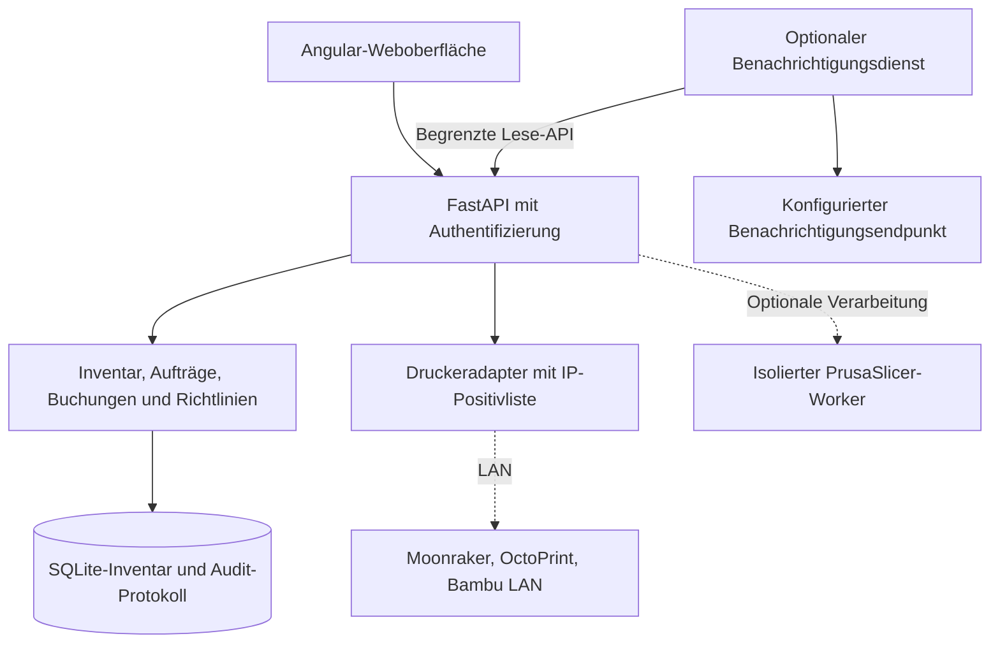

<picture>
  <source media="(prefers-color-scheme: dark)" srcset="docs/branding/banner-dark.svg">
  
</picture>

# Spoolmera

**Marke und UI-Design:** [Logo sowie helle und dunkle Designvorlagen](docs/branding/README.md) (Konzeptgrafiken, keine Produktscreenshots).

**Sprache:** [English](README.md) · **Deutsch**

[](https://github.com/Cenn0/Spoolmera/actions/workflows/ci.yml)
[](LICENSE)

**Direkt zu:** [Oberfläche](#oberfläche) · [Funktionen](#funktionen) · [Docker-Schnellstart](#schnellstart-mit-docker) · [Architektur](#architektur) · [Druckersicherheit](#druckeranbindung-und-sicherheit) · [Dokumentation](docs/README.md)

**Dein selbst gehosteter Arbeitsbereich für den 3D-Druck:** Filamentprodukte, einzelne Spulen, Lagerorte, Druckaufträge und unterstützte lokale Drucker zentral verwalten.

[](https://github.com/Cenn0/Spoolmera/actions/workflows/codeql.yml)

> **Status: experimentelles Open-Source-Projekt v0.10.0.** Verhalten an realen Geräten und betriebliche Belastungsgrenzen sind nur eingeschränkt überprüft. Die reguläre CI speichert keine herunterladbaren Build-Artefakte. Versionstags können experimentelle Testpakete unter [Releases](https://github.com/Cenn0/Spoolmera/releases) bereitstellen. Prüfsummen bestätigen Dateiintegrität, keine signierte Herkunft.

## Oberfläche


<details>
<summary>Weitere Screenshots – Spulenbestand, Lagerorte und mobile Ansicht</summary>


</details>

Die Screenshots verwenden synthetische Beispieldaten, keine verbundenen physischen Drucker. Siehe [Herkunft der Screenshots](docs/screenshots/README.md).

## Funktionen

- **Filamente und Spulen:** Produktkatalog, Materialien/Farben, individuelle physische Spulen, Rest-/Leergewicht, Lagerort, Zustand und Hinweise auf niedrigen Bestand.
- **Lagerverwaltung:** Suche, Filter, farbige Karten, Lagerortübersicht, Drag-and-drop mit alternativer Bedienung, transaktionale Buchungen, manuelles Wiegen und nachvollziehbare Korrekturen.
- **Etiketten und Import:** Druckbare QR-Etiketten, CSV-Import/-Export und einmaliger Spoolman-JSON-Snapshot-Import (keine laufende Synchronisierung).
- **Druckaufträge:** Nachverfolgung, G-Code-/3MF-Metadaten, Zuordnung von Druckwerkzeugen zu Spulen und Abgleich von geschätztem und tatsächlichem Verbrauch.
- **Druckeranbindung:** Lokales Moonraker/Klipper, OctoPrint und ein **experimenteller, nicht offizieller Bambu-Lab-LAN-MQTT-Adapter**.
- **Betrieb:** Rollenbasierter Zugriff, Einrichtung des ersten Administrators, Diagnose, abgesicherte SQLite-Backups und -Wiederherstellung. Optional isolierter Slicing-Worker und Benachrichtigungsdienst.
- **Oberfläche:** Responsive Angular-Weboberfläche mit Deutsch/Englisch und hellem/dunklem Design.

Ein erfasster Druckauftrag, importierte Metadaten oder eine unverbindliche Materialreservierung **starten keinen physischen Druck und buchen nicht automatisch Material ab**. Eine explizit aktivierte Bambu-Funktion kann bei eindeutig zugeordnetem Druckabschluss den **geschätzten** Verbrauch buchen. Unklare Vorgänge müssen manuell geprüft werden.

## Schnellstart mit Docker

Voraussetzung sind Docker Engine/Desktop mit Compose und Git. Das Standard-Image enthält die gebaute Angular-Oberfläche sowie den Python-/FastAPI-Server.

```bash
git clone https://github.com/Cenn0/Spoolmera.git
cd Spoolmera
cp .env.example .env

# Zufälligen Token erzeugen und den Wert als SPOOLMERA_BOOTSTRAP_TOKEN in .env eintragen:
python3 -c 'import secrets; print(secrets.token_urlsafe(32))'

docker compose up -d --build
```

Öffne **http://127.0.0.1:8765** auf dem Docker-Host. Lege mit dem Bootstrap-Token und einem Passwort von **mindestens 14 Zeichen** den ersten Administrator an. Es gibt **kein Standard-Adminpasswort**; ohne Bootstrap-Token ist die Ersteinrichtung blockiert.

```bash
docker compose ps
docker compose logs -f spoolmera
docker compose down
```

Die Daten liegen dauerhaft im Volume `spoolmera_data`. **`docker compose down -v` löscht das Volume.** Vor Updates oder zerstörerischen Aktionen Backups erstellen und deren Wiederherstellung prüfen.

Der HTTP-Port bindet standardmäßig nur an **Loopback**. Für andere Geräte einen vertrauenswürdigen VPN-Zugang oder einen HTTPS-Reverse-Proxy verwenden, `SPOOLMERA_PUBLIC_BASE_URL` korrekt setzen und sichere Cookies aktivieren. Login- und Druckersteuerungsschnittstellen nicht direkt im Internet bereitstellen. Siehe [Deployment](docs/deployment.md) und [Sicherheit](docs/security-and-printers.md).

## Druckeranbindung und Sicherheit

| Integration | Aktuelles Verhalten | Nachweisgrenze |
| --- | --- | --- |
| **Moonraker/Klipper** | Status; optional Upload und Start/Pause/Fortsetzen/Abbrechen | Mit simulierten Controllern getestet; keine überprüften Nachweise an realen Geräten |
| **OctoPrint** | Status; optionale G-Code-Übertragung und Befehle | Mit simulierten Controllern getestet; Abschlussbuchungen benötigen Prüfung |
| **Bambu Lab LAN MQTT** | Lokaler Status/AMS-Daten; ausgewählte optionale Steuerbefehle und zugeordneter geschätzter Verbrauch | **Community-Adapter ohne offizielle Bambu-Lab-Unterstützung**; abhängig von Firmware und Zertifikats-Pinning |

**Technisch implementiert bedeutet weder herstellerseitig unterstützt noch Best Practice oder an realer Hardware sicher verifiziert.** Druckerbefehle sind standardmäßig deaktiviert und müssen ausdrücklich freigeschaltet werden. Rechte minimieren, private IP-Adressen gezielt zulassen, TLS verwenden und erste Hardwaretests beaufsichtigen. Es gibt keine native Hersteller-Cloud-Anmeldung oder universell garantierte Hardwarekompatibilität. Die [Hardware-Kompatibilitätsmatrix](docs/hardware-compatibility.md) unterscheidet automatisierte Simulationen ausdrücklich von noch ausstehenden Tests an realen Geräten und Firmwareständen.

Der optionale PrusaSlicer-Worker und der Benachrichtigungsdienst laufen über separate, explizit aktivierte Compose-Erweiterungen und gehören nicht zum Standard-Ein-Container-Betrieb. Vor der Aktivierung [Integrationen](docs/integrations.md), [Betrieb](docs/operations.md) und [Druckersicherheit](docs/security-and-printers.md) lesen.

## Architektur

Spoolmera verwendet einen modularen Monolithen mit **Python 3.12, FastAPI und SQLite** und stellt eine gebaute **Angular-22**-Oberfläche bereit. Unterstützt wird ein Anwendungsprozess pro SQLite-Datenbank; ein Message-Broker oder Kubernetes werden nicht benötigt.



Slicer und Benachrichtigungen werden nur über zusätzliche Compose-Konfigurationen aktiviert. Physische Druckerbefehle sind standardmäßig deaktiviert; Simulationen belegen keine echte Gerätekompatibilität. Siehe [Architekturdetails](docs/architecture.md) und [Hardware-Nachweise](docs/hardware-compatibility.md).

### Entwicklung

Für die lokale Entwicklung Python 3.12 und eine laut `frontend/package.json` kompatible Node.js-Version verwenden:

```bash
python3.12 -m venv .venv
source .venv/bin/activate
python -m pip install --require-hashes -r requirements-dev.txt
python -m pytest -q
python scripts/check_docs.py

cd frontend
npm ci
npm run typecheck
npm run i18n:check
npm test
npm run build
```

Die CI enthält außerdem Container-, Browser-, Migrations-/Recovery- und Abhängigkeitsprüfungen. Simulierte Integrationen und bestandene Tests sind **kein Sicherheits- oder Kompatibilitätsnachweis für reale Drucker**. Siehe [Tests](docs/testing.md) und [Architektur](docs/architecture.md).

## Mitwirken und Fehler melden

Beiträge sollten reproduzierbare Tests und passende Ergänzungen zur [Betriebsdokumentation](docs/README.md) enthalten. Sicherheitslücken über den [vertraulichen Meldeweg](SECURITY.md) melden; in öffentlichen Issues nur anonymisierte Testspulen und simulierte Druckerantworten verwenden. Reale Druckerbefehle benötigen beaufsichtigte Tests; die CI prüft keine physische Hardwarefunktion.

## Dokumentation und Lizenz

[Dokumentationsindex](docs/README.md) · [Installation und Backups](docs/deployment.md) · [Funktionsumfang und Roadmap](docs/roadmap-implementation.md) · [Oberfläche](docs/interface-ux.md) · [Druckersicherheit](docs/security-and-printers.md) · [Mitwirken](CONTRIBUTING.md) · [Sicherheitsrichtlinie](SECURITY.md)

Spoolmera steht unter [Apache-2.0](LICENSE). Drittanbieterbibliotheken behalten ihre eigenen Lizenzen. Insbesondere verwendet der **optionale** PrusaSlicer-Worker AGPL-3.0-Komponenten, die nicht Teil des Standard-Images sind. Siehe [Drittanbieterlizenzen](THIRD_PARTY_LICENSES.md) und [Lizenzkonformität](docs/license-compliance.md). Sicherheitslücken bitte vertraulich gemäß [SECURITY.md](SECURITY.md) melden.
