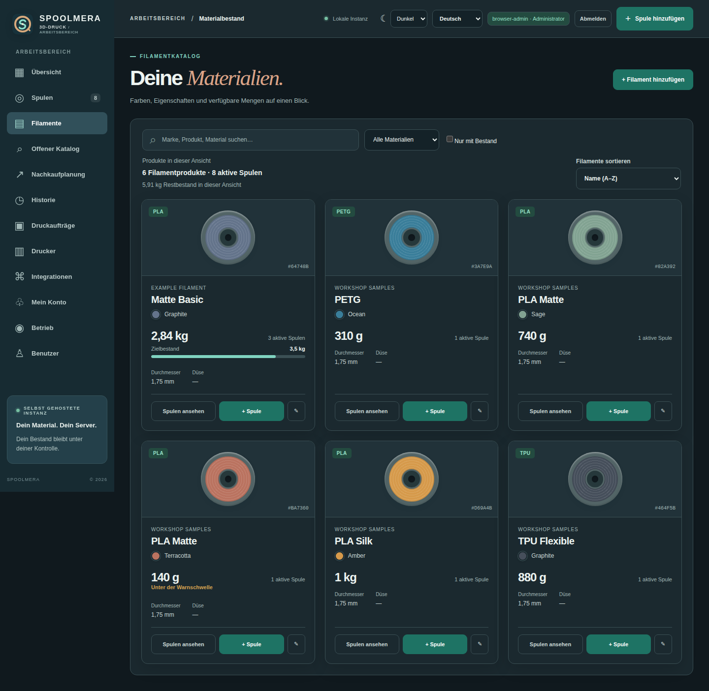
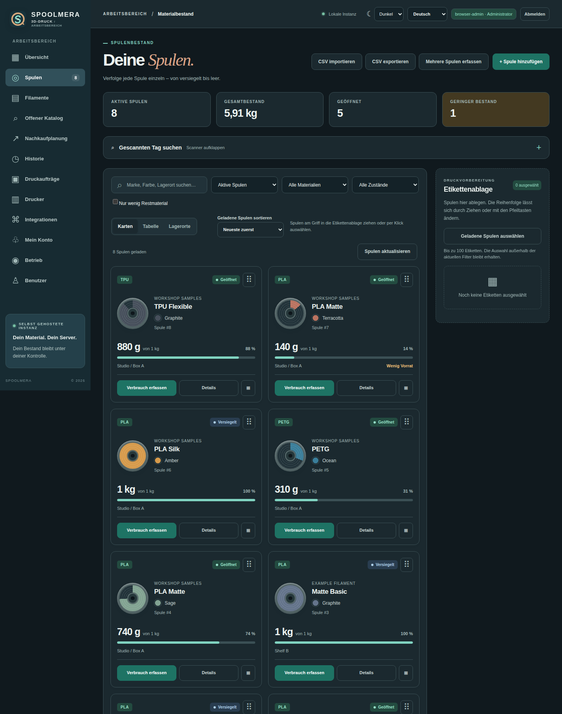
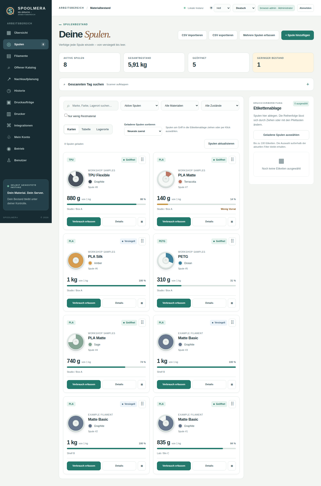
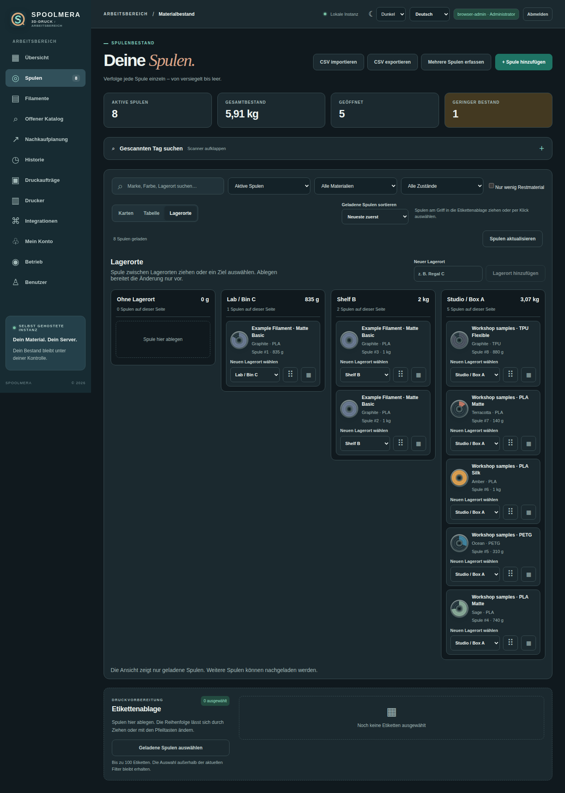
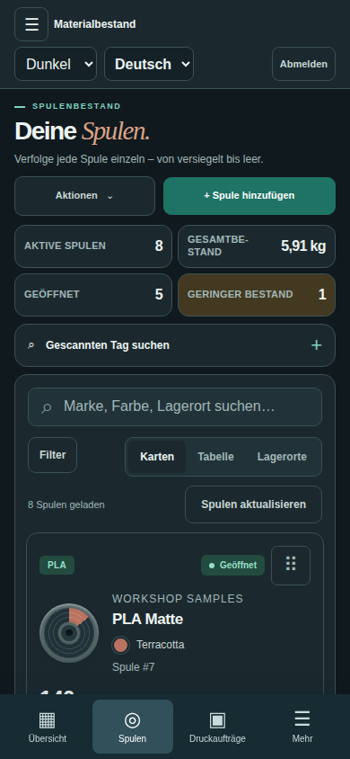

# Spoolmera

**Language:** **English** · [Deutsch](README.de.md)

[](https://github.com/Cenn0/Spoolmera/actions/workflows/ci.yml)
[](LICENSE)

**Explore:** [Interface](#interface) · [Features](#features) · [Docker quick start](#quick-start-with-docker) · [Printer safety](#printer-integration-and-safety) · [Docs](docs/README.md)


**Your self-hosted 3D printing workspace:** manage filament products, individual spools, storage locations, print jobs and supported local printer connections.

[](https://github.com/Cenn0/Spoolmera/actions/workflows/codeql.yml)

> **Status: experimental v0.10.0.** Source code is available; this is not a certified printer-control system or a stable hosted service. CI artifacts are test builds, not signed product releases.

## Interface



<details>
<summary>More screenshots — spool inventory, storage locations and mobile view</summary>









</details>

Screenshots use synthetic demonstration data, not connected physical hardware. See [screenshot provenance](docs/screenshots/README.md).

## Features

- **Filaments and spools:** Product catalog, material/color variants, individual physical spools, remaining/tare weight, locations, conditions and low-stock indications.
- **Inventory workflow:** Search and filters, color-coded cards, storage board, drag-and-drop with alternatives, transactional movements, manual weighing and traceable corrections.
- **Labels and import:** Printable QR labels, CSV import/export and one-time Spoolman JSON snapshot import (not ongoing synchronization).
- **Printing:** Print-job tracking, G-code/3MF metadata inspection, explicit mapping from tools to spools and review of estimated versus actual use.
- **Connections:** Local Moonraker/Klipper, OctoPrint and an **experimental, unofficial Bambu Lab LAN MQTT adapter**.
- **Operations:** Role-based access, first-run admin setup, diagnostics and guarded SQLite backup/restore. Optional isolated slicing worker and notification sidecar.
- **Interface:** Responsive Angular web app with English/German localization and light/dark modes.

A print job, imported metadata or advisory reservation does **not** automatically start a physical print or deduct material. An explicitly enabled Bambu completion workflow can record **estimated** consumption after strict task correlation; uncertain outcomes require manual review.

## Quick start with Docker

Requires Docker Engine/Desktop with Compose and Git. The default image contains the built Angular frontend and Python/FastAPI backend.

```bash
git clone https://github.com/Cenn0/Spoolmera.git
cd Spoolmera
cp .env.example .env

# Generate a secret, then set SPOOLMERA_BOOTSTRAP_TOKEN to its value in .env:
python3 -c 'import secrets; print(secrets.token_urlsafe(32))'

docker compose up -d --build
```

Open **http://127.0.0.1:8765** on the Docker host. Set up the first administrator with the bootstrap token and a password of **at least 14 characters**. There is **no default admin password**; initial setup is blocked if the token is absent.

```bash
docker compose ps
docker compose logs -f spoolmera
docker compose down
```

Data is stored in the persistent `spoolmera_data` volume. **`docker compose down -v` deletes the volume**; verify backups before upgrades or destructive operations.

The default HTTP port listens on **loopback only**. For other devices, use a trusted VPN or HTTPS reverse proxy, configure a correct `SPOOLMERA_PUBLIC_BASE_URL` and enable secure cookies. Never directly expose login or printer-control interfaces to the internet. See [deployment](docs/deployment.md) and [security](docs/security-and-printers.md).

## Printer integration and safety

| Integration | Current behavior | Verification boundary |
| --- | --- | --- |
| **Moonraker/Klipper** | Status; optional upload and start/pause/resume/cancel actions | Tested against simulated controllers; no physical printer certification |
| **OctoPrint** | Status; optional G-code transfer and commands | Tested against simulated controllers; completion accounting requires review |
| **Bambu Lab LAN MQTT** | Local status/AMS data; selected opt-in controls and correlated estimated consumption | **Community adapter, not officially supported by Bambu Lab**; depends on firmware and certificate pinning |

**Implemented is not the same as manufacturer-supported, recommended or certified secure.** Printer commands are disabled by default and require explicit operator enablement. Follow least-privilege access, private-IP allowlists, suitable TLS controls and supervised hardware testing. No native manufacturer-cloud login/control or guaranteed universal hardware compatibility is provided.

The optional PrusaSlicer worker and notifications use separate opt-in Compose overlays, not the default single-container deployment. Read [integrations](docs/integrations.md), [operations](docs/operations.md) and [printer security](docs/security-and-printers.md) before enabling them.

## Architecture and development

Spoolmera runs as a **Python 3.12/FastAPI modular monolith with SQLite**, serving a built **Angular 22** frontend. The supported deployment is a single application process per SQLite database; no broker or Kubernetes cluster is required.

For source development, use Python 3.12 and a Node.js version allowed by `frontend/package.json`:

```bash
python3.12 -m venv .venv
source .venv/bin/activate
python -m pip install --require-hashes -r requirements-dev.txt
python -m pytest -q
python scripts/check_docs.py

cd frontend
npm ci
npm run typecheck
npm run i18n:check
npm test
npm run build
```

CI additionally runs targeted container, browser, migration/recovery and dependency checks. Simulated integrations and passing automated tests do not prove compatibility or safety on real printers. See [testing](docs/testing.md) and [architecture](docs/architecture.md).

## Contributing and public reports

Contributions should include a reproducible test and update the relevant [operating guide](docs/README.md). Report a vulnerability using the [private security process](SECURITY.md); use sanitized example spools and simulated printer responses in public issues. Real hardware commands require supervised testing and are not certified by CI.

## Documentation and license

[Documentation index](docs/README.md) · [Deployment and backups](docs/deployment.md) · [Features and roadmap](docs/roadmap-implementation.md) · [Interface](docs/interface-ux.md) · [Security and printers](docs/security-and-printers.md) · [Contributing](CONTRIBUTING.md) · [Security policy](SECURITY.md)

Spoolmera is licensed under [Apache-2.0](LICENSE). Third-party dependencies retain their own licenses. In particular, the **optional** PrusaSlicer worker involves AGPL-3.0 components and is not part of the default app image; see [third-party notices](THIRD_PARTY_LICENSES.md) and [license compliance](docs/license-compliance.md). Report vulnerabilities privately through [SECURITY.md](SECURITY.md).
