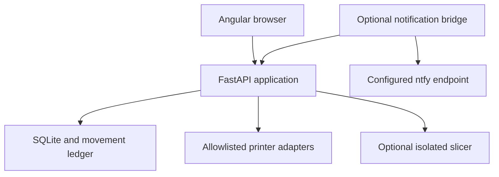

# Spoolmera architecture (v0.10.0)

Spoolmera is a free, Apache-2.0-licensed, AI-developed and human-engineered self-hosted application. It remains a modular monolith: one FastAPI process owns a SQLite database and serves compiled Angular assets. No Node runtime, message broker, hosted account or external database is required in the default application container.

## Deployment and boundaries

The supported baseline is **one API worker per database on a single host**, using a local filesystem. The container runs as UID/GID 10001, with a read-only root filesystem, a persistent `/data` volume and a bounded temporary directory. Compose binds to loopback by default. Concurrent HTTP users share this process; a second application lifespan for the same database is rejected before migration.

The optional slicer is an additional container on an internal Docker network. It has a separate token, trusted read-only profiles and resource limits, but no SQLite volume, printer credentials or published port. It produces downloadable G-code. The optional notifier has a scoped read-only application token, separate notification-service credentials and its own persistent deduplication state.

Moonraker and OctoPrint adapters validate exact private IP allowlists before network access, reject redirects and proxies, and bound request and response sizes. Native vendor-cloud login/control is not implemented. Signed relay events are a separate boundary and do not establish physical material use.

## Code ownership

| Area | Responsibility |
| --- | --- |
| `app/main.py` | Application composition, lifespan ownership, static assets, liveness and readiness |
| `app/api/` | HTTP requests, explicit route policies, response schemas and service results |
| `app/core/` | Role policies and validated operator settings |
| `app/services/accounting_service.py` | Job consumption, linked corrections, weighing overlap and measurement anchors |
| `app/services/command_service.py` | Durable intents and per-printer upload/start coordination |
| `app/services/inventory_query_service.py` | Paged history/archive, batch registration and restock calculations |
| `app/services/polling_runtime.py` | Polling ownership, heartbeat, supervision and shutdown |
| `app/services/backup_service.py` | Bounded SQLite snapshot creation, validation and operational metadata |
| `app/infrastructure/` | Additive database migrations and normalized controller adapters |
| `frontend/src/app/features/` | Lazily loaded pages with their own templates and focused tests |
| `scripts/` | Recovery commands, contract generation, optional notifier and integration smoke tests |

Touched workflows use HTTP → service → database/device boundaries. Existing adapter and parsing modules remain where their ownership is already clear. The implementation does not introduce a parallel class hierarchy or a repository-wide rewrite.

## Persistent model

Current SQLite schema version: **10**.

| Entity | Meaning |
| --- | --- |
| `products`, `spools` | Product properties and physical rolls with stable UUIDs |
| `movements` | Immutable inventory events with actor, source and correction/operation links |
| `print_jobs`, `job_materials` | Physical tracking state and explicit tool-to-spool estimates |
| `job_consumption_totals`, `accounting_operations` | Attributed use and durable, idempotent review decisions |
| `stock_measurements` | Weighing anchors, including readings with no balance difference |
| `scale_event_receipts` | Signed measurements awaiting review with original revision/tare context |
| `print_runs`, `printer_commands` | Controller-native run evidence and physical command history |
| `printer_operations`, `printer_operation_history` | Per-printer exclusion and upload/release history |
| `job_reservations`, `printer_spool_slots` | Advisory quantities and the operator's record of loaded rolls |
| `inventory_batch_receipts` | Retry identity for atomically registered batches |
| `application_metadata`, `worker_leases`, `printer_poll_state` | Recovery identity and operational state |
| `users`, `auth_sessions`, `audit_events`, `automation_tokens` | Authorization, revocation and accountability |

## Accounting invariants

Weights use integer grams. Every stock or tare change advances the spool revision in the same transaction. Original tool assignments and estimates remain available; multiple tools using one roll are aggregated before stock changes. Every mapped physical spool succeeds or the whole accounting transaction rolls back.

`GET/POST /api/jobs/{id}/consumption` separates **physical job state** from **accounting state**. Editors explicitly choose actual totals, the original estimate, or no use. An actual value of zero is deliberate. An unobserved pending registration must first be stopped or acquire evidence of a physical operation; it cannot be charged merely by existing in the queue.

Repeated request IDs return their stored result. Reusing an ID with different input is rejected. Accounting revisions reject stale edits. Correcting a previous 200 g booking to 37 g normally creates a linked +163 g movement; it does not edit the original movement. Later controller confirmation cannot charge an already reviewed job again.

### Weighing and corrections

An absolute weight does not explain which job consumed material. Ordinary weighing rejects overlap with an observed or uncertain-start job whose consumption still needs review. The consumption dialog can explicitly attribute the job's use and include a current weighing in the same transaction.

Scale receipts retain stock revision, empty-roll tare, net/gross weight and observation time. A stale receipt cannot overwrite a later balance. Old receipts without reliable context require a fresh measurement.

If a weighing corrects stock after a job was charged and the job total is subsequently changed, a plain compensation could count the weighing difference twice. Persistent measurement anchors detect this ordering. The review requires a current explicit measurement and records both the job correction and measurement adjustment together. Measurement adjustment rows retain an accounting-operation link but have no direct `print_job_id`, so cost/usage aggregation excludes them from print consumption. Job history still includes them through the shared operation.

## Printer operation lifecycle

Registration, logical slot assignment and reservation never start a printer. Physical control remains an explicit administrator opt-in. Before persisting start intent, a short write transaction rechecks the printer's enabled state, current active spool stock and consistency of all material estimates. Advisory reservations and logical loaded slots remain separately visible.

A durable per-printer operation excludes another start or upload while the existing operation is unresolved. Network I/O runs outside the database transaction. An explicit 4xx rejection releases the rejected intent; uncertain transport or server outcomes remain blocked. A successful response acknowledges dispatch, but only controller evidence can confirm physical execution.

An unambiguous Moonraker history run first seen in progress and later completed can settle estimated use and release its operation. OctoPrint's generic idle status is insufficient for this conclusion. Unknown starts and uploads survive restart and are never automatically retried. Confirmed historical commands retain separate release state, so they do not permanently block the next job.

Physical cancellation and Stop tracking retain an unresolved operation until an administrator verifies that it ended and records a reason, or sufficient controller evidence resolves it. Accounting review alone does not release printer control. Changing the endpoint, controller kind or credential binding is blocked while registered or unresolved work still relies on that connection.

## Polling, readiness and diagnostics

Startup validates poll cadence, relevant feature flags, backup bounds and public origin settings. The API lifespan holds a kernel application lock. The poller holds a separate kernel lock and renews a 30-second SQLite lease every 10 seconds. After process termination, the replacement can obtain kernel ownership and replace the orphaned polling lease without waiting for the old 30-minute lease window.

Cancelling `asyncio.to_thread` does not stop its underlying I/O. Shutdown retains polling ownership until the bounded callback actually returns. A lost heartbeat stops further cycles. Printer-operation records are independent of the worker lease and remain intact when polling ownership changes.

`/api/health` checks API/database liveness. `/api/ready` also checks the actual worker task and supervised state; Compose uses readiness. An ordinary offline printer appears as a device failure while polling can remain healthy. Editor/admin diagnostics expose lease identity, worker activity, device freshness/failures, unresolved operations, backup/storage/recovery state and suspicious historical material sums. Secrets and arbitrary exception messages are not returned.

## Migration and recovery

Version-gated migrations retain numeric IDs, UUIDs and ledger history. A legacy single-spool job receives T0 only when it has no material rows. Restarts do not add an inferred T0 to legitimate T3 or multi-tool mappings. Read-only diagnostics flag suspicious historical material sums; they do not guess which historical rows or stock values to rewrite.

Backups use SQLite's online backup API. Logical page count, WAL growth, free-space reserve, copy duration, output size and concurrent ownership are bounded. A failed or cancelled download removes its temporary snapshot and releases ownership.

Offline restore validates application identity, supported schema, integrity, foreign keys and any supplied manifest before replacement. It tests migration on the candidate, preserves corrupt target bytes and sidecars, and retains runtime owner/mode. A running API blocks restore even with a dead poller. The final replacement is atomic; a failed candidate never becomes the active target.

Restore rotates the instance epoch and revokes restored browser sessions and machine tokens. Operators log in again and reissue machine credentials. Printer-operation uncertainty is retained. The notifier detects the epoch change, reports recovery and rebuilds its condition baseline, so an old cursor cannot suppress future notifications. See the supported commands in [Operations](operations.md).

## Frontend consistency and feature policy

TypeScript declarations are generated from Pydantic job, accounting, measurement, slot, import, inventory and diagnostics contracts. CI rejects stale output. File previews retain immutable input plus request ownership; a new file/source or dialog target invalidates earlier results. Import results report current created/skipped counts if inventory changed after preview.

Inventory changes and relevant route/focus activation refresh affected data. Optional purchase values can be updated or cleared. Archive lookup preserves UUID links; reactivation is explicit and audited. History and spool browsing filter on the server and load additional pages. Batch confirmation creates 1–100 individual rolls atomically and reuses a durable request ID on uncertain retries.

Restock suggestions are `max(0, product target − active physical stock)`. Archived stock is excluded, products without active rolls are included, and reserved/available quantities are shown separately. No supplier order is placed. Notifications cover configured low-stock, review-required and repeated device-failure conditions with durable deduplication; delivery remains at least once across a crash after sending.

## Validation and extension limits

The five CI gates cover backend/focused Angular tests, default Docker/recovery/notifier workflows, real browser workflows, optional real STL-to-G-code slicing, and dependency audits. Locked inputs and updates are described in [Build reproducibility](build-reproducibility.md). The versioned test artifact contains its image, start instructions, metadata and checksums; public release is a separate operation.

Controller actions are substituted in routine tests. No printer/firmware combination, NFC reader or physical scale is certified. Supported upstream interfaces, application tests and hardware validation are distinct claims. Multi-host SQLite, automatic print queues/purchasing, vendor-cloud login, OIDC/SSO and roll changes during a job remain outside this implementation.
