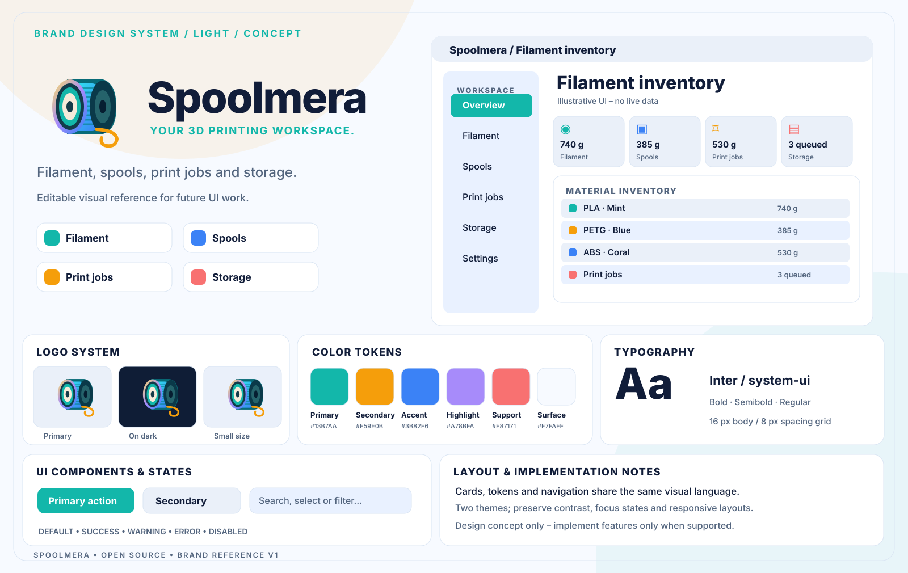
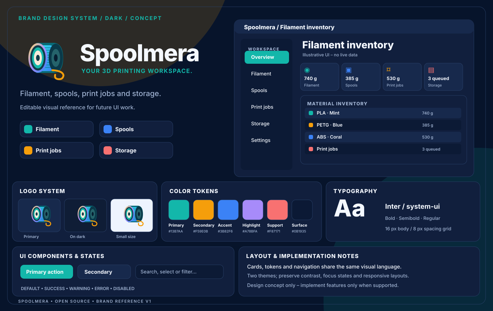

# Spoolmera branding and UI design references

## Brand banners

The light and dark banners include the project's existing filament-spool brand symbol, product name, and the established slogan. The README uses a theme-aware `<picture>` element to select the banner without scripts.

- [Light banner](banner-light.svg)
- [Dark banner](banner-dark.svg)

The [compact mark](logo.svg) remains appropriate for navigation and favicons; the banner is intended for README headers and presentations, not for replacing interactive UI components. All SVGs are self-contained with no external fonts or images.

**Status:** visual design concepts, not screenshots, shipped features, or evidence of product readiness.

| Asset | Purpose |
| --- | --- |
| [Logo](logo.svg) | Shared self-contained SVG brand mark |
| [Light design](design-light.svg) | Light-theme palette, layout and component reference |
| [Dark design](design-dark.svg) | Dark-theme palette, layout and component reference |

## Design tokens

| Token | Color |
| --- | --- |
| Primary | `#13B7AA` |
| Secondary | `#F59E0B` |
| Accent | `#3B82F6` |
| Highlight | `#A78BFA` |
| Support | `#F87171` |
| Dark surface | `#0C1A35` |
| Light surface | `#F7FAFF` |
| Light text | `#111D39` |
| Dark text | `#F4F8FF` |

Typeface: Inter with operating-system fallbacks. Base spacing grid: 8 px. Text, action and status colors require contrast testing. Never use color alone to convey status.

**Product-specific focus:** Filament, spools, print jobs and storage. The mock interface is **illustrative** and can contain workflows that are not yet implemented. Read the product README, architecture, roadmap, tests and security documentation before treating an element as supported.

## Integration contract

- Keep the existing build/runtime asset locations functional; the logo at the canonical location is shared by README, app and desktop/browser icon where applicable.
- Keep the light and dark SVGs as standalone design references; do not embed them as functional application UI.
- Use self-contained SVG with no remote fonts, scripts, images, tracking, or private details.
- Do not put access tokens, personal email addresses, real user records or internal infrastructure in public design assets.
- Validate accessibility (keyboard navigation, readable contrast, legible minimum size), localized text, mobile breakpoints and actual screenshots separately.
- **Trademark note:** these are project design assets; trademark distinctiveness and registration have not been legally verified. Do not claim exclusivity.

Only Spoolmera is covered here; designs from other projects are not licensed or imported by this directory.
